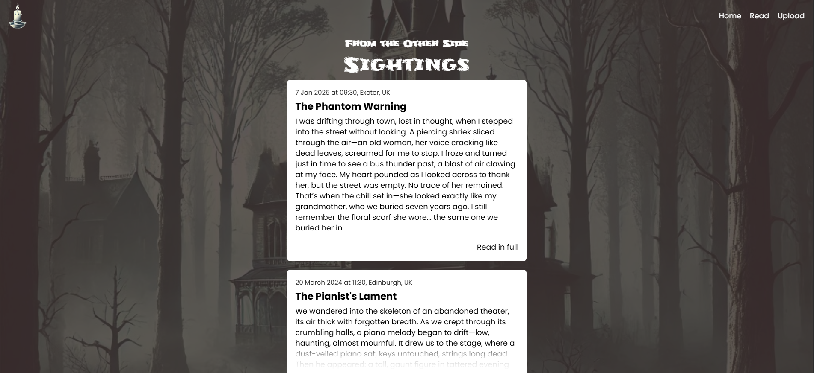

# Paranormal Sightings Blog

A full-stack monorepo web application for sharing and reading paranormal sightings. Built with a native Node.js REST API and a React frontend.



## 🔗 Links

- **Live Frontend Demo:** [View Live Site](https://paranormal-sightings-blog.vercel.app/)    
- **Live API Endpoint:** [View API Endpoint](https://paranormal-sightings-api.onrender.com/api)      
- **GitHub Repository:** [View Source Code](https://github.com/iviktorry/paranormal-sightings-blog)  

---

## Tech Stack & Architecture

### Monorepo Structure

```text
paranormal-sightings-blog/
├── backend/            <-- Pure Node.js REST API (Render)
│   ├── data/
│   │   └── data.json   <-- JSON file storage
│   ├── server.js
│   └── package.json
├── frontend/           <-- React SPA (Vercel)
│   ├── src/
│   └── package.json
└── README.md
```

### Stack

- **Frontend:** React 19, React Router DOM 7, Vite, Tailwind CSS.
- **Backend:** Node.js (`http`, `fs/promises`), JSON File Storage.
- **Deployment:** Vercel (Frontend), Render (Backend).

---

## API & Routes

### Client Routes

| Path               | Page / Feature                               |
| ------------------ | -------------------------------------------- |
| `/`                | Home page                                    |
| `/sightings`       | Read sightings list (fetched from API)       |
| `/upload-sighting` | Upload sighting form (submits `POST` to API) |
| `*`                | Not-Found page                               |

### Server Endpoints

| Method    | Endpoint | Description                                    |
| --------- | -------- | ---------------------------------------------- |
| `GET`     | `/api`   | Reads all sightings from `data.json`.          |
| `POST`    | `/api`   | Appends a new sighting payload to `data.json`. |
| `OPTIONS` | `/*`     | Global CORS preflight handler.                 |

---

## Getting Started

### Installation

```bash
git clone [https://github.com/iviktorry/paranormal-sightings-blog.git](https://github.com/iviktorry/paranormal-sightings-blog.git)
cd paranormal-sightings-blog

# Install frontend dependencies
cd frontend && npm install

# Install backend dependencies
cd ../backend && npm install
```

### Environment Setup

Create `frontend/.env.development`:

```env
VITE_API_URL=http://localhost:7000/api
```

### Local Run

Run backend and frontend in separate terminals:

```bash
# Terminal 1: Backend (http://localhost:7000)
cd backend && npm run dev

# Terminal 2: Frontend
cd frontend && npm run dev
```

---

## 👩‍💻 Author

[](https://github.com/iviktorry)
[](https://linkedin.com/in/victoria-pratkina-b23834388)
[](https://www.frontendmentor.io/profile/iviktorry)
[](https://t.me/wsxxdfv)
